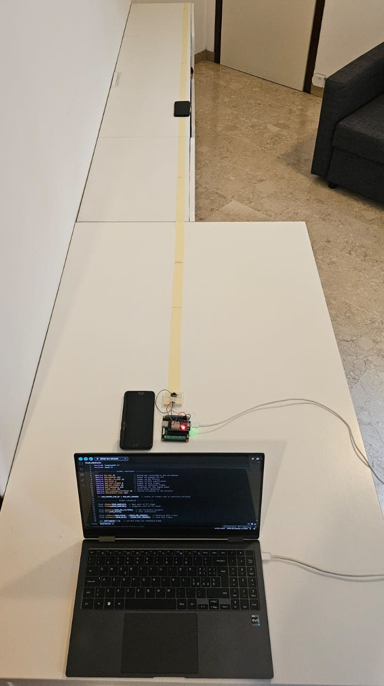

# Low-Cost MFCC-Based Real-Time Sound Recognition

Real-time recognition of a **user-defined sound** on an **ESP32**, fully on-device: no cloud, no neural networks.
The system learns a target sound (an alarm, a doorbell, a knock, a spoken word…) in a few seconds and then detects it
in real time by comparing **MFCC feature matrices** with a sliding-window **Frobenius distance** and an **adaptive threshold**.

> University team project, Politecnico di Milano (A.Y. 2025-26).

<p align="center">
  
</p>

## Highlights

- Runs on a low-cost ESP32 using **~26 kB of RAM**
- Learns a new sound on demand, with no dataset and no offline training
- **92–100 % detection rate** at matched learning/monitoring distances (0.5–3 m)
- Robust to moderate background noise (60 dB), with **no false positives** in the background-noise tests and against
  three similar alarms (spoken words are harder, see [Results](#results))
- First-detection latency typically **0.5–2.5 s**

## How it works

```
 microphone ─► ADC (~8 kHz) ─► 512-sample frame ─► DC removal ─► high-pass IIR ─► RMS normalization
                                                                                         │
                                       RMS < threshold? ──► discard frame ◄──────────────┤
                                                                                         ▼
                                  Hamming window ─► FFT ─► 20 Mel filters ─► log ─► DCT ─► MFCC c1..c5
```

1. **Learning, stage 1:** when you send `L`, the device waits for a frame louder than the RMS threshold and records
   `Nr = 20` consecutive frames. Their MFCCs form the **reference matrix** `R` (5 × 20).
2. **Learning, stage 2:** while the target sound keeps playing, the device builds **test matrices** `T` (5 × 8),
   computes the minimum distance to `R` and collects 50 distances. The detection threshold `d_th` is a percentile of
   these distances, lowered adaptively until it is close to the smallest ones.
3. **Monitoring:** every new frame updates `T` (sliding window). The sound is detected when

   $$d_{min} = \min_s \lVert T - R_s \rVert_F < d_{th}$$

   where `R_s` is the 5 × 8 submatrix of `R` starting at column `s`. After a detection the test matrix is cleared and
   the device pauses for 1 s.

## Hardware

| Component     | Part                                               |
| ------------- | -------------------------------------------------- |
| Microcontroller | ESP32 dev board (dual-core Xtensa LX6, 240 MHz)  |
| Microphone    | MAX9814 electret microphone amplifier with AGC     |

Wiring:

| MAX9814 | ESP32   |
| ------- | ------- |
| VDD     | 3V3     |
| GND     | GND     |
| OUT     | GPIO 15 |

> GPIO 15 is the pin used in the measurements below, but it is not the best choice for a new build: it belongs to
> ADC2, which cannot be used while Wi-Fi is active, and it is a strapping pin, sampled at boot (if it is low, the boot
> messages on the serial port are silenced). For a new build, connect the microphone to an input-only ADC1 pin such as
> GPIO 34 and update `MIC_PIN`.

## Getting started

1. Install the [Arduino IDE](https://www.arduino.cc/en/software) and the **esp32** board package by Espressif.
2. Install the **arduinoFFT** library (version 2.x) from the Library Manager.
3. Open [`firmware/sound_recognition/sound_recognition.ino`](firmware/sound_recognition/sound_recognition.ino),
   select your ESP32 board and upload.
4. Open the Serial Monitor at **115200 baud**.
5. Send **`L`**, play the target sound and keep it playing until `Learning complete.` appears.
6. From then on, every occurrence of the sound prints `SOUND DETECTED`. Send `L` again to learn a new sound.
7. Send **`C`** at any time to cancel the learning or stop the monitoring, for example if the target sound never
   exceeds the activation level and the device keeps waiting in stage 1.

With `arduino-cli`:

```sh
arduino-cli lib install arduinoFFT
arduino-cli compile --fqbn esp32:esp32:esp32 firmware/sound_recognition
arduino-cli upload  --fqbn esp32:esp32:esp32 -p <PORT> firmware/sound_recognition
```

## Configuration

All parameters are `#define`s at the top of the sketch. The defaults are the values tuned experimentally during the project:

| Parameter                | Default | Meaning                                                    |
| ------------------------ | ------- | ---------------------------------------------------------- |
| `NUM_SAMPLES`            | 512     | Frame / FFT size                                           |
| `SAMPLE_DELAY_US`        | 79      | Inter-sample delay, giving fs ≈ 8 kHz                      |
| `NUM_MEL_FILTERS`        | 20      | Mel filterbank size                                        |
| `NUM_MFCCS`              | 6       | MFCCs computed; c0 is dropped, so 5 are used               |
| `NUM_REF_FRAMES`         | 20      | Reference frames. Use fewer (8–12) for short or impulsive sounds |
| `NUM_TEST_FRAMES`        | 8       | Test frames (must be smaller than `NUM_REF_FRAMES`)        |
| `RMS_THRESHOLD`          | 225     | Activation level in ADC units (room silence ≈ 50)          |
| `PAUSE_TIME_MS`          | 1000    | Dead time after a detection                                |
| `LOG_DISTANCES`          | 0       | `1` prints the best distance of every frame, useful for tuning |
| `ENABLE_EXPERIMENT_LOG`  | 0       | `1` prints the ~30 s START/STOP summaries used for the measurements below |

## Results

Measured with the original project firmware in a quiet indoor room, during 30 s monitoring windows, with the target
sound played periodically from a smartphone.

| Sound             | Learning / monitoring distance | Detection rate |
| ----------------- | ------------------------------ | -------------- |
| Emergency alarm   | 0.5 m / 0.5 m                  | 94 %           |
| Emergency alarm   | 1.5 m / 1.5 m                  | 100 %          |
| Emergency alarm   | 3.0 m / 3.0 m                  | 100 %          |
| Jingle            | 0.5 m / 0.5 m                  | 92 %           |
| Jingle            | 3.0 m / 3.0 m                  | 100 %          |
| Emergency alarm   | cross-distance (all pairs)     | 88–94 %        |
| Emergency alarm   | 60 dB background noise         | 94 %           |

When trained on one alarm and tested against three acoustically similar alarms, the system produced no false
detections: the minimum distance stayed 1.5–2.25× above the threshold.

Live sounds are harder. A learned spoken word ("stop", same voice) was detected in 9 of 15 repetitions (60 %). It was
never triggered by "top", "shop" or "drop", but "stock" caused 2 false detections out of 15. A knock learned on one
surface was detected in 18 of 20 repetitions (90 %) and never triggered by knocks on two other surfaces.

## Limitations

- Each target sound must be learned on its own. The system matches templates and does not generalize across sound classes.
- Detection stops working under strong background noise (≈ 68 dB in the tests).
- Learning should happen in a quiet environment. For discontinuous sounds, start the learning right before the
  informative part of the sound.
- The reference matrix lives in RAM and is lost on reset.

## Repository structure

```
├── firmware/sound_recognition/sound_recognition.ino   ESP32 sketch
└── docs/images/                                       Figures
```

## Authors

Developed by **Marco Vanzetto** with three fellow students of the MSc in Engineering Physics at
Politecnico di Milano, as a team project.

## License

Released under the [MIT License](LICENSE).
